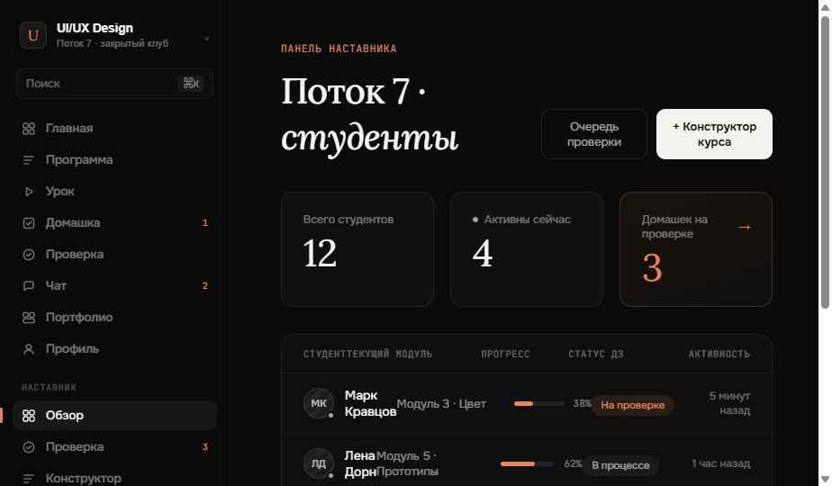

# Obusch / Design Club

Full-stack learning workspace for a mentor and students. The platform combines lessons, assignments, reviews, portfolio work, course building, and realtime communication in one dark editorial interface.

## Product flows

### Student

- works through lessons with video, materials, and checklists;
- submits assignments with files;
- receives rubric-based reviews and revision requests;
- maintains a portfolio;
- chats with the mentor in realtime.

### Mentor

- monitors students and progress;
- reviews work in a dedicated queue;
- grades by criteria and accepts or returns submissions;
- builds modules, lessons, and assignments;
- communicates with students through realtime chat.

## Tech stack

`Node.js` · `Express` · `Socket.IO` · `multer` · `bcryptjs` · session-based authentication · JSON persistence

## Local development

```bash
npm install
npm start
```

Open `http://localhost:3000`. Register the mentor first, then create student accounts that will be assigned to that mentor.

## Environment variables

| Variable | Purpose |
|---|---|
| `PORT` | Application port |
| `NODE_ENV=production` | Enables secure cookies over HTTPS |
| `SESSION_SECRET` | Production session secret |
| `DATA_DIR` | Persistent database and upload directory |

Deployment notes are available in [DEPLOY.md](DEPLOY.md).


## Работа с изменениями и безопасность

Ветки задач, проверки CI, локальный Gitleaks и правила работы с секретами описаны в [CONTRIBUTING.md](CONTRIBUTING.md).

## Status

Learning-platform prototype. Validate authentication, persistence, upload storage and deployment configuration before using it with real students.


